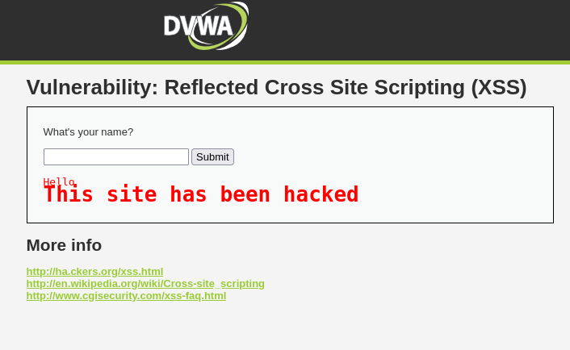
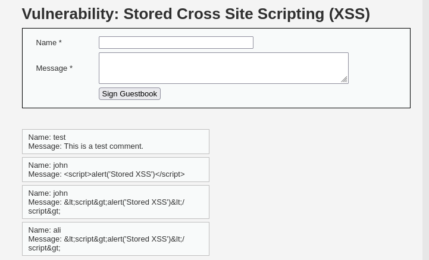

# DVWA: Stored and Reflected XSS

**Target:** DVWA (Damn Vulnerable Web App), in my own lab

## Reflected XSS

DVWA's reflected XSS page takes a name as input and prints it straight back onto the page with no filtering. Submitting `` as the name runs that script immediately, since the browser treats it as real code rather than plain text.

In a real website, this could be used to steal a visitor's login cookies, redirect them to a fake page to steal their password, or deface the page itself. It only works once, on whoever clicks a malicious link containing the payload.

## Stored XSS

The guestbook page is more dangerous. Whatever gets submitted to the Name or Message field is saved to the database and displayed to every visitor, not just the person who submitted it. Submitting `` as a message means the script now runs automatically for every single person who ever loads that page afterwards, silently, with no link needed.

## Impact

Reflected XSS needs a victim to click something. Stored XSS doesn't, it just sits there and fires for everyone who visits, which in a real website could mean quietly stealing every visitor's session cookie in the background.

## Fix, in a real environment

* Never trust user input. Escape special characters like `<` and `>` before displaying anything back to the page, so they're treated as plain text instead of code
* Apply this to every field that stores or displays user input, not just the obvious ones
* Use a Content Security Policy as a second layer of defence, even if input validation fails somewhere
